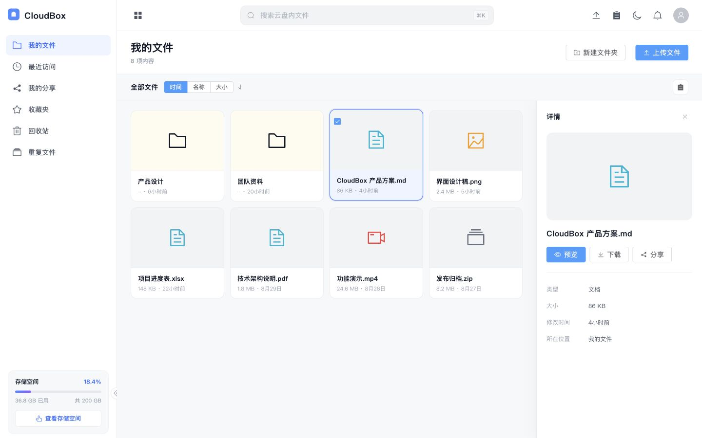
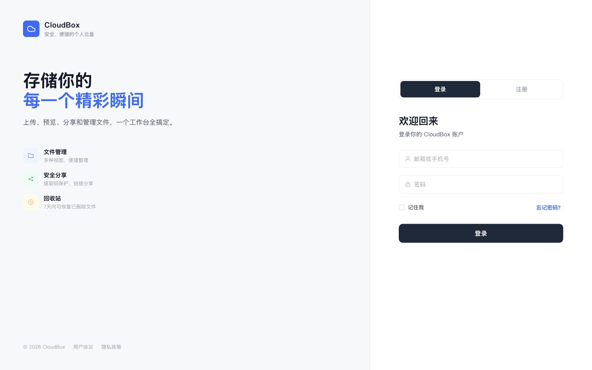
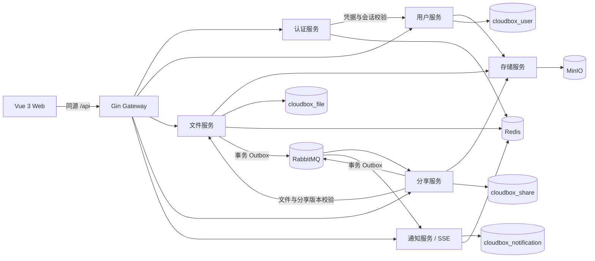

<div align="center">
  <h1>Go Cloud Storage</h1>
  <p><strong>CloudBox —— 一个面向 Web 的现代化私有云盘。</strong></p>
  <p>使用 Go、Vue 3 与 MinIO 构建，覆盖文件上传、在线预览、搜索、分享、回收站和实时通知。</p>

  <p>
    
    
    
    
    
  </p>

  <p>
    <a href="#界面预览">界面预览</a> ·
    <a href="#功能亮点">功能亮点</a> ·
    <a href="#快速开始">快速开始</a> ·
    <a href="#架构">架构</a> ·
    <a href="#api-概览">API</a>
  </p>
</div>

## 项目简介

Go Cloud Storage 是一个前后端分离的私有云存储项目，产品界面名称为 **CloudBox**。它以桌面 Web 文件工作区为核心，后端由网关及认证、用户、文件、存储、分享、通知服务组成，前端提供网格/列表浏览、详情面板、上传队列和预览体验。

项目适合用于学习完整的云盘业务链路、自托管实验以及在此基础上继续开发。目前仅维护 **Web 桌面端**，不包含移动端页面或移动端适配承诺。

## 界面预览

### 文件工作区

网格与列表双视图、文件详情、排序、搜索、上传和批量操作集中在同一个桌面工作区中。



### 登录与注册

登录、注册、忘记密码与重置密码使用统一的认证体验。



> 截图基于当前代码的 1440 × 900 桌面 Web 界面生成；示例文件和容量数据仅用于展示。

## 功能亮点

| 能力 | 说明 |
| --- | --- |
| 文件工作区 | 文件夹导航、网格/列表视图、排序、多选、拖拽移动、复制、重命名和删除 |
| 大文件上传 | 10 MiB 阈值自动切换分片上传，支持并发分片、进度、暂停/继续、取消与秒传 |
| 在线预览 | 支持图片轮播、音视频、PDF、文本和 Markdown；Markdown 内容经 DOMPurify 清洗 |
| 搜索与整理 | 文件搜索、搜索历史、最近访问、类型分类、收藏夹和重复文件检测 |
| 安全分享 | 分享链接、可选提取码、有效期、下载权限以及提取码暴力破解防护 |
| 回收站 | 软删除、单个/批量恢复、永久删除以及 7 天过期清理 |
| 下载 | 普通下载、Range 分段下载、预签名直链和批量 ZIP 下载 |
| 实时体验 | SSE 通知、上传队列、存储配额展示、浅色/深色主题和常用快捷键 |
| 账户安全 | HttpOnly Cookie 会话、Access/Refresh Token、CSRF 校验、接口限流和密码重置 |

常用快捷键：`Ctrl/Cmd + U` 上传、`Ctrl/Cmd + F` 搜索、`Ctrl/Cmd + A` 全选，按 `?` 查看快捷键帮助。

## 架构

后端采用单仓库微服务结构。网关及六个服务各自拥有独立入口与私有实现，七个进程可独立构建和启动，业务数据由四个独立 schema 和数据库账号管理；开发环境默认共用一个 MySQL 实例。服务之间通过内部 HTTP 和 RabbitMQ 协作。



| 服务 | 职责与数据归属 |
| --- | --- |
| gateway | 公开 API 路由、请求 ID、流式代理；不暴露内部存储接口 |
| auth-service | 登录、注册入口、刷新与退出、JWT 内省；使用 Redis 会话 |
| user-service | 用户资料、密码、头像及密码重置；拥有用户库 |
| file-service | 文件、目录、分片上传、下载、收藏、配额和回收站；拥有文件库 |
| storage-service | MinIO 对象操作、分片、Range、缩略图和预签名 URL；不访问业务数据库 |
| share-service | 分享链接、提取码、有效期与统计；拥有分享库 |
| notification-service | 站内通知持久化及 SSE 推送；拥有通知库 |

- **可靠事件**：业务数据与 Outbox 同事务提交，RabbitMQ 确认投递，消费者使用 Inbox 去重。
- **文件生命周期**：删除递增分享版本，防止消息延迟导致旧链接复活；永久删除通过持久化任务重试物理对象清理。
- **依赖**：微服务模式要求 Redis 和 RabbitMQ；Redis 保存会话、分片状态和搜索历史，并用于通知实例间分发。
- **代码边界**：每个服务的业务、模型、仓储、HTTP 接口与启动装配位于自己的 `internal/`，Go 编译器禁止跨服务导入。共用一个 `go.mod`，公共包只包含协议、通用端口与基础设施，不包含共享业务模型。`backend/architecture` 的测试持续检查依赖边界。

认证使用 Redis 保存每个账号的当前会话 ID；重新登录会替换旧会话，退出会同时撤销 Access/Refresh Token。Redis 不可用时认证失败关闭，返回 503，不清除客户端 Cookie。升级到会话 ID 版本后，旧令牌需要重新登录；更新时应同步替换所有认证服务和文件服务实例，避免旧实例继续使用旧的撤销或分片清理规则。

分享下载、预览及缩略图的签名时长限制在分享剩余有效期以内。取消分享会阻止新签名，但已发出的对象存储直链仍可用至其签名到期。SSE 每个服务实例最多 5000 条连接、每用户最多 8 条连接。

本次不包含 AI、向量库、文件夹分享或完整文件版本历史。详细服务协议见 [微服务说明](backend/services/README.md)，旧数据迁移与回退要求见 [迁移指南](deploy/MIGRATION.md)。

## 技术栈

| 层级 | 技术 |
| --- | --- |
| Web | Vue 3、Vue Router 4、Vuex 4、Element Plus、Axios |
| 内容与上传 | Marked、DOMPurify、SparkMD5 |
| API | Go 1.25.6、Gin、GORM、Viper、slog |
| 数据 | MySQL 8、Redis、MinIO、RabbitMQ |
| 工程化 | Vue CLI 5、Go Modules、npm、Docker Compose、GitHub Actions |

## 快速开始

### 环境要求

推荐通过 Docker Compose 启动后端及基础设施，在宿主机运行前端。

| 依赖 | 用途 |
| --- | --- |
| Docker 与 Compose v2 | 构建七个后端服务，并运行 MySQL 8.0、Redis 7、RabbitMQ 3.13、MinIO |
| Node.js 20 或更高、npm | 安装和运行 Vue 前端 |
| Go 1.25.6 | 仅宿主机开发、测试或不使用容器构建时需要 |
| Python 3 | 仅运行自动化集成测试和迁移演练时需要 |

### 1. 获取代码

```bash
git clone https://github.com/xg-debug/go-cloud-storage.git
cd go-cloud-storage
```

### 2. 配置并启动微服务

```bash
cp deploy/.env.example deploy/.env
```

编辑 `deploy/.env`，替换所有 `replace-me-*` 占位值。为数据库、RabbitMQ 和 MinIO 设置独立密码；JWT、服务间调用和存储调用的密钥各自至少 32 字节，且互不相同。可使用 `openssl rand -hex 32` 生成随机值，RabbitMQ 密码须使用 URL-safe 字符。

```bash
docker compose --env-file deploy/.env -f deploy/compose.yaml config --quiet
docker compose --env-file deploy/.env -f deploy/compose.yaml up --build -d
docker compose --env-file deploy/.env -f deploy/compose.yaml ps
```

Compose 在全新数据卷中创建四个数据库及独立账号，服务通过开发用 AutoMigrate 创建所属表。**已有数据必须先按 [迁移指南](deploy/MIGRATION.md) 备份并迁移，不要用包含 DROP TABLE 的 `db.sql` 升级现有数据库。**

- 网关：`http://localhost:8081`。
- MinIO S3：`http://localhost:9000`；控制台：`http://localhost:9001`。
- MinIO 从固定官方源码提交构建并校验 SHA256，首次构建需要下载源码及依赖。
- 前端通过短期签名 URL 访问私有对象。跨机器使用时，须将 `GCS_MINIO_PUBLIC_ENDPOINT` 改为浏览器可达地址。
- Compose 默认使用 `172.30.0.0/24` 网段；若与本机网络冲突，修改网段时同步调整网关固定 IP 和可信代理配置。
- `/healthz` 表示进程存活，不代表所有下游依赖可用。密码重置邮件需要另行配置 SMTP。

停止服务并保留数据：

```bash
docker compose --env-file deploy/.env -f deploy/compose.yaml down
```

不使用 Docker 的启动步骤、服务代码归属及旧入口退役说明见 [运行说明](backend/services/README.md)。

### 3. 启动前端

打开另一个终端：

```bash
cd frontend
npm ci
cp .env.example .env.local
npm run serve
```

浏览器访问 `http://localhost:8080`。开发环境默认使用 `/api` 同源路径，并由 Vue Dev Server 代理到 `http://localhost:8081`；如需修改目标服务，请调整 `.env.local`：

```dotenv
VUE_APP_API_BASE_URL=/api
VUE_APP_DEV_API_TARGET=http://localhost:8081
```

## 项目结构

```text
go-cloud-storage/
├── backend/
│   ├── gateway/
│   │   ├── cmd/server/         # 独立网关入口
│   │   └── internal/transport/ # 公开路由与流式代理
│   ├── services/
│   │   ├── auth-service/       # 认证、会话与用户 RPC 客户端
│   │   ├── user-service/       # 用户业务、用户模型及用户库仓储
│   │   ├── file-service/       # 文件业务、分片、配额、回收站及文件库仓储
│   │   ├── storage-service/    # 对象 HTTP 接口与 MinIO 适配器
│   │   ├── share-service/      # 分享业务、分享库及文件 RPC 客户端
│   │   └── notification-service/ # 通知业务、通知库与事件消费者
│   ├── pkg/
│   │   ├── contracts/         # 服务间 HTTP DTO，无 ORM 模型
│   │   ├── rpc/               # 内部 RPC 客户端、鉴权与请求校验
│   │   ├── storagehttp/       # 对象协议与流式客户端
│   │   ├── ports/             # 通用存储、事务和事件接口
│   │   └── platform/          # MySQL/Redis 连接、事务与可靠消息基础设施
│   ├── architecture/          # 服务依赖边界测试，包含在 go test ./...
│   ├── conf/                  # 配置模板
│   ├── migrations/            # 历史数据与增量 SQL
│   └── go.mod                 # 单仓库共用依赖版本，不代表单进程
├── frontend/
│   ├── public/                 # 静态资源与 PWA 图标
│   └── src/
│       ├── api/                # API 调用封装
│       ├── components/         # 布局与业务组件
│       ├── composables/        # 文件操作组合逻辑
│       ├── config/             # Web 运行时配置
│       ├── services/           # 认证会话服务
│       ├── store/              # Vuex 状态与上传队列
│       └── views/              # 页面视图
├── image/                      # README 界面截图
├── deploy/                     # Compose、镜像、配置模板、迁移与验收记录
├── scripts/
│   ├── integration/            # 七服务联调、Compose 验证和迁移演练
│   └── perf/                   # 性能测试脚本
├── db.sql                      # 单体全新建库结构，不能用于升级已有库
└── README.md
```

以文件服务为例，源码在所属服务内完成分层：

```text
backend/services/file-service/
├── cmd/server/main.go
└── internal/
    ├── bootstrap/       # 配置、依赖装配、路由、所属表迁移和后台任务
    ├── application/     # 文件、上传下载、回收站等业务
    ├── domain/          # 仅文件服务使用的模型与 DTO
    ├── ports/           # 文件读写、分片会话接口
    ├── adapters/        # 文件库仓储、Redis 会话、分享 RPC 客户端
    └── transport/       # HTTP 控制器和内部文件接口
```

认证与存储服务按实际职责保留所需层级，不创建空的业务或数据库目录。旧 `backend/cmd/main.go` 单体入口和过渡 Compose 已退役；如需旧版本回退，应使用迁移前保存的代码、镜像及配置，不能让旧入口直接写入拆分后的数据库。

## API 概览

| 模块 | 主要接口 |
| --- | --- |
| 认证 | `POST /login`、`/register`、`/refresh-token`、`/logout`，`GET /me` |
| 用户 | `PUT /user/update`、`/user/password`，`POST /user/avatar`，`GET /user/stats` |
| 文件 | `/file/list`、`/upload`、`/create-folder`、`/move`、`/copy`、`/rename`、`/search` |
| 分片上传 | `/file/chunk/init`、`/upload`、`/merge`、`/cancel`、`/progress` |
| 预览与下载 | `GET /file/preview/:id`、`/preview-stream/:id`、`/download/:id`，`POST /download-batch` |
| 收藏与分类 | `/favorite`、`/category/files`、`/file/recent`、`/file/duplicates` |
| 回收站 | `/recycle` 及单个/批量恢复、永久删除接口 |
| 分享 | `/share` 管理接口，`/s/:token` 公开访问与下载 |
| 通知 | `/notification` 管理接口与 `/notification/stream` SSE 流 |

浏览器通过网关的 `/api` 前缀访问上述接口；网关转发到所属服务。受保护接口校验会话，写操作进行 CSRF 校验；公开分享接口按 IP 限流，并对提取码错误进行额外保护。

## 安全说明

- Access Token 与 Refresh Token 默认写入 `HttpOnly` Cookie，写操作同时校验 CSRF Token。
- MinIO Bucket 强制保持私有，外部访问使用受控接口或短期预签名 URL。
- Markdown 预览在插入 DOM 前使用 DOMPurify 清洗，降低存储型 XSS 风险。
- 日志只记录请求路径而不记录查询字符串，避免令牌等敏感参数进入日志。
- 配置模板不含真实凭据；`backend/conf/*.yaml` 与本地 `.env*` 不应提交到仓库。

部署到公网前，还应配置 HTTPS、反向代理可信来源、独立数据库账号、强随机密钥、备份策略和对象存储生命周期策略。

## 开发与验证

在仓库根目录执行：

```bash
# 后端测试与静态检查
(cd backend && go test ./... && go test -race ./... && go vet ./...)

# 可选：针对独立测试 Redis 执行真实会话与锁回归；CI 自动提供 Redis
(cd backend && GCS_TEST_REDIS_ADDR=127.0.0.1:16389 go test ./services/auth-service/internal/transport ./services/file-service/internal/adapters/cache)

# 前端测试与生产构建
(cd frontend && npm ci && npm test && npm run build)

# 七服务容器联调与隔离迁移演练，需要 Docker 和 Python 3
python3 scripts/integration/microservices_smoke.py --containers --migration-rehearsal

# 校验仓库原始 Compose 部署配置
python3 scripts/integration/compose_deployment_smoke.py
```

集成脚本只操作其创建的临时项目和测试数据，结束后清理对应容器与卷。迁移演练覆盖逐行核对、业务恢复和反向复制，不代表真实生产数据迁移或旧应用回退验收。

历史基线：2026-10-14，合并 [PR #3](https://github.com/xg-debug/go-cloud-storage/pull/3) 前的 [Backend CI #42](https://github.com/xg-debug/go-cloud-storage/actions/runs/38521570380) 已通过后端测试、race、vet、宿主机联调、默认镜像构建、容器迁移演练及原始 Compose 验证。前端测试和生产构建已在本地通过。详细测试范围见 [验收记录](deploy/VERIFICATION.md)。

本次服务源码边界改造（代码提交 `2294627`）已通过 [Backend CI #45](https://github.com/xg-debug/go-cloud-storage/actions/runs/38572672730)：后端测试、全量 race、vet、宿主机联调、默认 Dockerfile 镜像构建、七服务容器迁移演练，以及原始 Compose 健康检查和业务验证全部通过。本地缓存镜像联调也已通过；本机 Docker Hub DNS 超时不影响上述远程默认构建验证结果。详细本地测试范围见 [验收记录](deploy/VERIFICATION.md)。

2026-10-15 的服务审计修复已通过本地全量 race、vet、真实 Redis 回归、七服务容器联调和隔离迁移演练。覆盖上传目录并发删除、SHA256 校验、退出撤销、分片会话归属、分享签名期限和 SSE 总连接限制；使用缓存基础镜像重新编译构建当前源码，未重新进行前端浏览器验收。修复提交 `9af608a` 的 [Backend CI #49](https://github.com/xg-debug/go-cloud-storage/actions/runs/38686958428) 也已全部通过，覆盖默认 Dockerfile 构建及原始 Compose 验证，并已通过 [PR #6](https://github.com/xg-debug/go-cloud-storage/pull/6) 合并到 `master`。详见 [验收记录](deploy/VERIFICATION.md)。

**目前尚未部署线上环境。** 目标服务器的 HTTPS、监控告警、备份恢复、容量与压力测试、依赖安全更新及真实数据迁移仍需验收。性能测试入口位于 [scripts/perf/README.md](scripts/perf/README.md)。

## 参与贡献

欢迎通过 [Issues](https://github.com/xg-debug/go-cloud-storage/issues) 报告问题或提出建议，也欢迎提交 Pull Request。建议在 PR 中说明变更动机、验证方式；界面调整请附桌面 Web 截图。

## 许可证

当前仓库尚未提交许可证文件。在许可证明确之前，仓库公开可见不等于自动授予复制、修改或分发权限。
