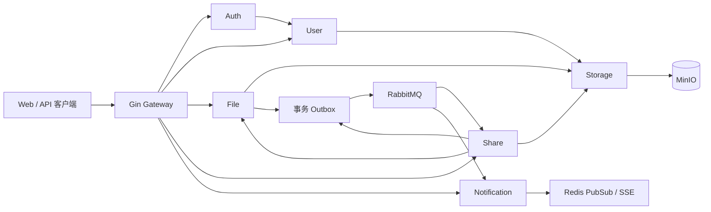

# 微服务拆分进度与运行说明

基线：远程 `refactor/modular-monolith-phase1`，提交 `af65a1a`。基线已抽出上传/下载 application、Storage/Redis/GORM 端口与适配器，但仍是共享数据库和进程内事件的模块化单体。本次将现有业务拆成七个可独立启动的进程，暂不加入 AI、向量库或文档解析。

## 服务与数据归属

| 进程 | 职责 | 独占数据 / 依赖 |
| --- | --- | --- |
| gateway | Gin 路由、请求 ID、流式代理、清除伪造身份头 | 无业务数据库；仅代理公开路由 |
| auth-service | 登录、注册入口、刷新、退出、JWT 内省 | Redis DB 0；通过内部 RPC 访问用户服务 |
| user-service | 用户、密码、头像、密码重置 | `cloudbox_user`：user、password_reset_token；远程存储 |
| file-service | 文件元数据、目录、上传/分片、下载、收藏、配额、回收站 | `cloudbox_file`：file、favorite、storage_quota、recycle_bin、event_outbox；Redis DB 1；远程存储 |
| storage-service | 对象、分片、Range、复制删除、缩略图、预签名 URL | MinIO；不连接业务数据库或 Redis |
| share-service | 分享链接、提取码、有效期、统计 | `cloudbox_share`：share、event_outbox、event_inbox；文件 RPC、远程存储 |
| notification-service | 站内通知、SSE 推送 | `cloudbox_notification`：notification、event_inbox；Redis DB 2 |

四个 schema 使用不同数据库账号，禁止跨库读取。开发环境共用 MySQL 实例，可配置为独立实例。认证服务通过用户服务验证当前凭据版本，修改密码后旧 JWT 在各服务失效。终端用户权限由各服务验证；网关不接受客户端提供的用户身份头。用户根目录与配额由文件服务按用户服务返回的 root ID 幂等建立。



现阶段共用 `backend/go.mod`、业务模型及部分实现，启动装配按服务选择依赖，不加载其他服务的数据库。`services/*/cmd/server` 是独立入口，`services/runtime` 负责装配，`internal/distributed` 定义内部 RPC 与消费处理，`infrastructure/eventing` 实现可靠事件。原 `cmd/main.go` 单体入口仍可使用。

## 事件与一致性

- 文件上传、分享创建、文件删除分别产生 `file.uploaded.v1`、`file.shared.v1`、`file.deleted.v1`。业务数据和 Outbox 在同一 MySQL 事务提交。
- Relay 使用 RabbitMQ 持久化消息和 publisher confirm，确认后标记已投递；故障恢复可能重复投递，Inbox 与消费业务写入同事务去重。
- 通知消费持久化后通过 Redis 发布到各实例 SSE；重试不会创建第二条通知。实时推送可能重复或因断线缺失，客户端应按通知 ID 去重并重新拉取列表。
- 文件软删除递增分享版本。分享访问实时检查文件版本，因此消息延迟也不会恢复旧链接；删除消费者只移除较旧版本的分享，避免误删恢复后新建的分享。
- 临时消费失败重入队列；非法事件进入 `cloudbox.dead`。生产运行需监控积压、检查死信并人工修复后重放。
- 数据库与对象存储不构成分布式原子事务。响应丢失仍可能产生孤儿对象，回收站物理对象删除由 `object_deletion` 持久化队列重试（含缩略图），上传响应丢失等其他孤儿对象仍需对账；已投递 Outbox / Inbox 的归档与保留策略尚需生产运维配置。

## 本地启动

在仓库根目录执行：

```sh
cp deploy/.env.example deploy/.env
# 替换所有凭据；JWT、SERVICE_TOKEN、STORAGE_TOKEN 至少 32 字节且用途间不同。
# openssl rand -hex 32 可生成密钥；RabbitMQ 密码使用 URL-safe 字符。
docker compose --env-file deploy/.env -f deploy/compose.yaml config --quiet
docker compose --env-file deploy/.env -f deploy/compose.yaml up --build -d
```

- 网关 `http://localhost:8081`；现有 Vue 开发代理兼容 `/api/*` 及去前缀路径。
- MinIO 由 `deploy/minio.Dockerfile` 从固定官方源码提交构建，校验源码 SHA256 并保留 AGPL 许可证，避免依赖已经无法拉取的旧镜像。源码依据：[官方构建说明](https://github.com/minio/minio#source-only-distribution)。首次构建需要下载 Go 依赖。MinIO S3 `http://localhost:9000`；控制台 `http://localhost:9001`。其他服务、数据库、Redis、RabbitMQ 不映射宿主机端口。
- MinIO 签名地址通过 `GCS_MINIO_PUBLIC_ENDPOINT` 设置为浏览器能访问的 `host:port`，跨机器部署必须修改。
- Compose 默认网段 `172.30.0.0/24`，固定网关 `172.30.0.2`，动态地址池 `172.30.0.128/25`，防止其他服务抢占网关地址。修改网段时同步修改 `services.example.yaml` 中 trustedProxies。
- `deploy/init-services.sh` 只在新 MySQL 数据卷执行，用于建立独立账号与空数据库。`GCS_AUTO_MIGRATE=true` 用于开发环境创建所属表；生产应使用审阅过的 DDL 与独立迁移账号。
- `/healthz` 表示进程存活，不是所有下游依赖就绪承诺。启动依赖短暂不可用时需重试业务请求。
- 密码重置邮件需要填写 SMTP。现有通知通道为站内通知 + SSE；未新增邮件通知模板或 WebSocket 通道。
- 停止并保留数据：`docker compose --env-file deploy/.env -f deploy/compose.yaml down`。

迁移已有数据前阅读 [迁移与回退说明](../../deploy/MIGRATION.md)。不要对已有数据库执行包含 DROP TABLE 的根目录 `db.sql`。

不使用 Docker 时，每个进程分别配置 `go-cloud-storage.dev.yaml`（参考 `deploy/services.example.yaml`），按 Compose 同名环境变量设置数据库、服务 URL 和令牌，在 `backend` 目录运行 `go run ./services/<name>-service/cmd/server`；网关运行 `go run ./cmd/gateway`。需事先启动 MySQL、Redis、RabbitMQ、MinIO。原单体 + 远程存储过渡拓扑保留在 `deploy/compose.monolith.yaml`；切换数据后不能直接回退写入旧库。

## 内部接口

业务 RPC 位于 `/internal/v1/`，使用 `GCS_SERVICE_TOKEN`；对象 API 位于 `/internal/storage/v1/`，使用独立 `GCS_STORAGE_TOKEN`。令牌代表可信服务身份，不替代终端用户授权。内部接口不得公开暴露，生产应使用私网、TLS 与独立服务身份。

对象 API：`PUT/GET object`、`PUT part`、`POST multipart/init|complete|abort`、`POST stat|hash|copy|delete|delete-many|delete-with-thumbnail|delete-thumbnail|thumbnail|url`、`POST presign/preview|download|stored`。上传下载是流，控制操作是 JSON；单次对象请求默认上限 10 GiB，可用 `GCS_STORAGE_MAX_BODY_BYTES` 调整。客户端不跟随重定向、不自动重试有副作用的请求，流中断不会被当作完整文件。

## 验证与边界

```sh
cd backend
go test ./...
go vet ./...
go test -race ./internal/distributed ./infrastructure/eventing ./internal/gateway ./services/storage-service/internal/transport ./infrastructure/minio
cd ..
python3 scripts/integration/microservices_smoke.py
# 同样业务检查，改为构建并启动七个应用容器
python3 scripts/integration/microservices_smoke.py --containers
# 校验原始部署定义中的健康检查、依赖顺序与固定网关地址
python3 scripts/integration/compose_deployment_smoke.py
```

集成脚本构建七个本机 Go 进程，使用独立临时 Docker 项目启动真实 MySQL/Redis/RabbitMQ/MinIO，并在结束后清理自己的容器和卷。覆盖注册登录、上传、Range、分享、通知、消费者重启补消费、删除恢复后的分享失效、数据库账号隔离、密码修改撤销会话；不修改现有业务数据。失败诊断保存在忽略目录 `backend/tmp/microservices-smoke/`。支持 `GCS_TEST_MYSQL_IMAGE`、`GCS_TEST_REDIS_IMAGE`、`GCS_TEST_RABBITMQ_IMAGE`、`GCS_TEST_MINIO_IMAGE` 覆盖镜像。

2026-10-08 已完成七个应用镜像构建与真实容器联调，使用默认 MySQL 8.0、Redis 7、RabbitMQ 3.13 以及固定官方源码构建的 MinIO。覆盖分片跨进程重启续传、完整下载哈希、消息队列停机补发、存储失败配额不变、认证/数据库故障恢复、会话撤销与跨时区时间格式。此前 Docker Hub EOF 和旧 MinIO 镜像不可拉取的阻塞已解决。CI 包含本机进程和应用容器两种模式；未提交到远端前，本次只能确认本地运行结果。

浏览器验证和已知上线缺口见 [验收记录](../../deploy/VERIFICATION.md)。这不是生产发布验收：仍需旧数据迁移演练、目标服务器配置、压力测试、备份监控、依赖安全更新以及生产存储版本维护方案。文件夹分享、完整文件版本历史等原项目未有功能未在本次额外实现。


本地离线镜像回退测试：当 Docker Hub 不可达，可以设置 `GCS_TEST_MYSQL_IMAGE`、`GCS_TEST_MINIO_IMAGE` 指向已有镜像，并使用 `--containers --local-runtime-image <已构建的CloudBox运行时镜像>`。脚本按镜像架构交叉编译当前代码，构建并运行七个应用容器；这覆盖容器运行行为，不代替默认 Dockerfile 从远端获取构建依赖的验证。追加 `--migration-rehearsal` 可执行临时数据迁移与反向复制演练。
